# Django Learning Management System

**A complete, modern learning platform built with Django — presented as Luma Learning.**

Discover courses, follow structured lessons, track progress, submit assignments, and test your knowledge. Instructors have a dedicated studio to build their own courses and give feedback; administrators manage the platform through a fully configured Django admin.

[Features](#features) · [Installation](#installation) · [Demo accounts](#demo-credentials) · [Screenshots](#screenshots) · [Testing](#testing)

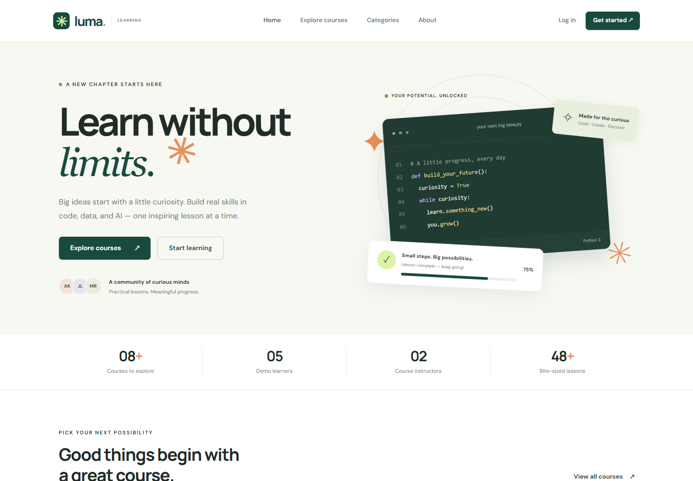

Built by [AliAdilQ](https://github.com/AliAdilQ) for [Django_Learning_Management_System](https://github.com/AliAdilQ/Django_Learning_Management_System). Luma is a fictional portfolio brand. Course content, reviews, and learner activity are demonstration data; this project does not claim to be a commercial or accredited learning provider.

## Features

| Area | Implemented functionality |
| --- | --- |
| Accounts | Registration, login, POST logout, password change, profiles, validated avatar uploads |
| Course discovery | Published course catalog, keyword search, category and difficulty filters, sorting, pagination, ratings |
| Student workspace | Enrollment collection, recently accessed courses, automatic lesson progress, pending assignments, quiz history, announcements |
| Learning | Ordered modules and lessons, optional HTTPS video links, curriculum sidebar, previous/next navigation, completion tracking |
| Instructor studio | Create, edit, and delete owned courses, modules, lessons, assignments, quizzes, questions, choices, and announcements |
| Assignments | Text/file submissions, updates before grading, late flags, maximum-mark validation, instructor feedback, protected downloads |
| Quizzes | Single-choice questions, weighted scoring, saved attempts and answer snapshots, pass/fail, optional server-enforced timer |
| Reviews | Enrolled-student ratings from 1–5, editable reviews, duplicate prevention, average course ratings |
| Administration | All 18 application models registered, search, filters, useful lists, inlines, and timestamp fields |
| Public pages | Homepage, categories, course details, about, locally stored contact messages, branded error pages |
| Interface | Responsive layouts, original SVG illustrations, reusable templates, alerts, empty states, keyboard focus and labeled forms |
| Repository | Committed migrations, repeatable seed command, integration tests, GitHub Actions, real screenshots, MIT license |

## Screenshots

These are **actual captures of the running, seeded Django application**, taken with Chromium. Desktop captures use a 1440-pixel-wide viewport; mobile captures use 390 pixels. The screenshot tool is included in `tools/browser_check.cjs`.

### Student workspace

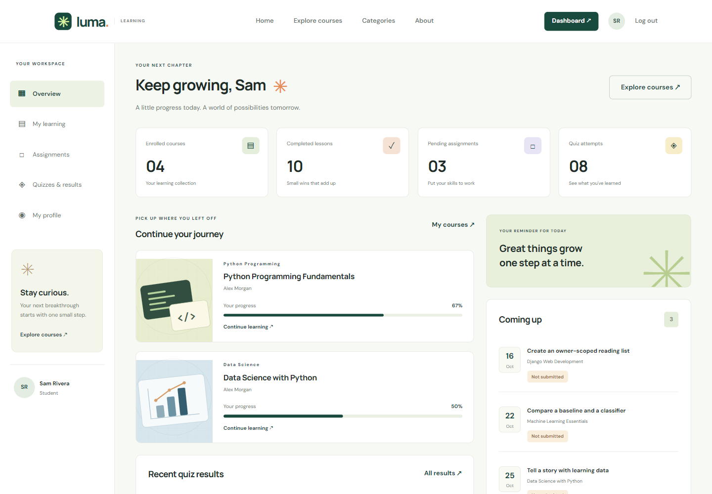

### Instructor studio

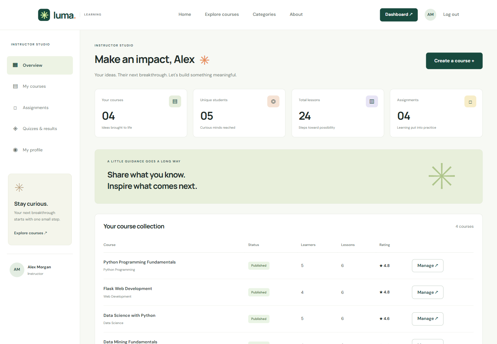

<details>
<summary><strong>Explore the course catalog, classroom, and admin gallery</strong></summary>

**Course catalog**

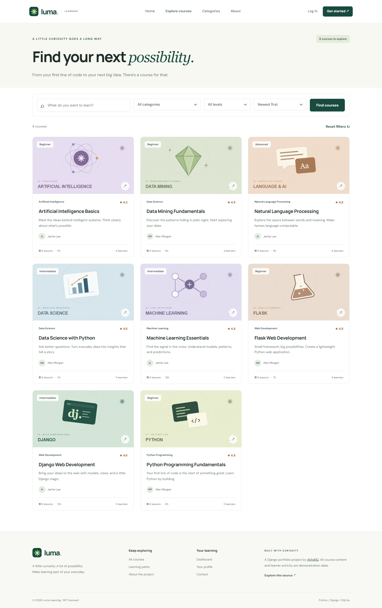

**Course overview and curriculum**

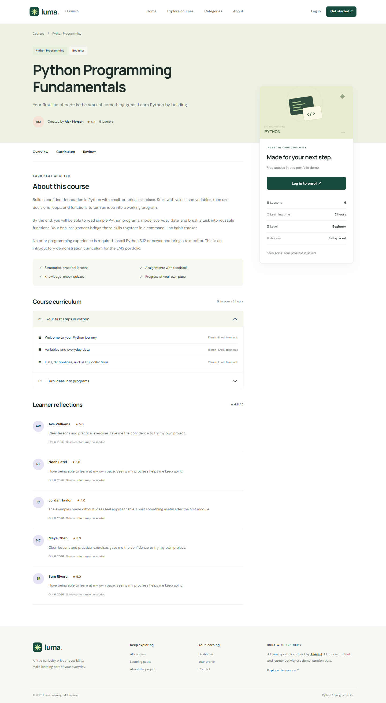

**Lesson classroom**

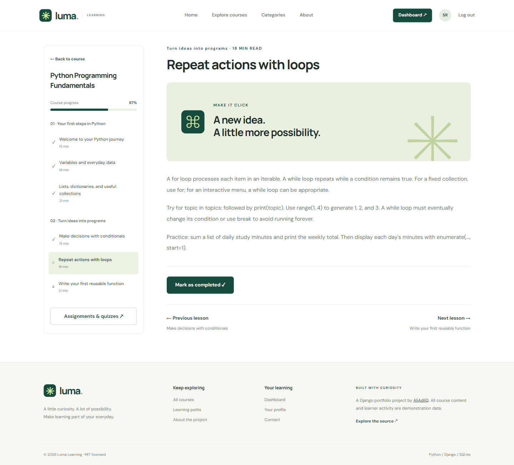

**Quiz**

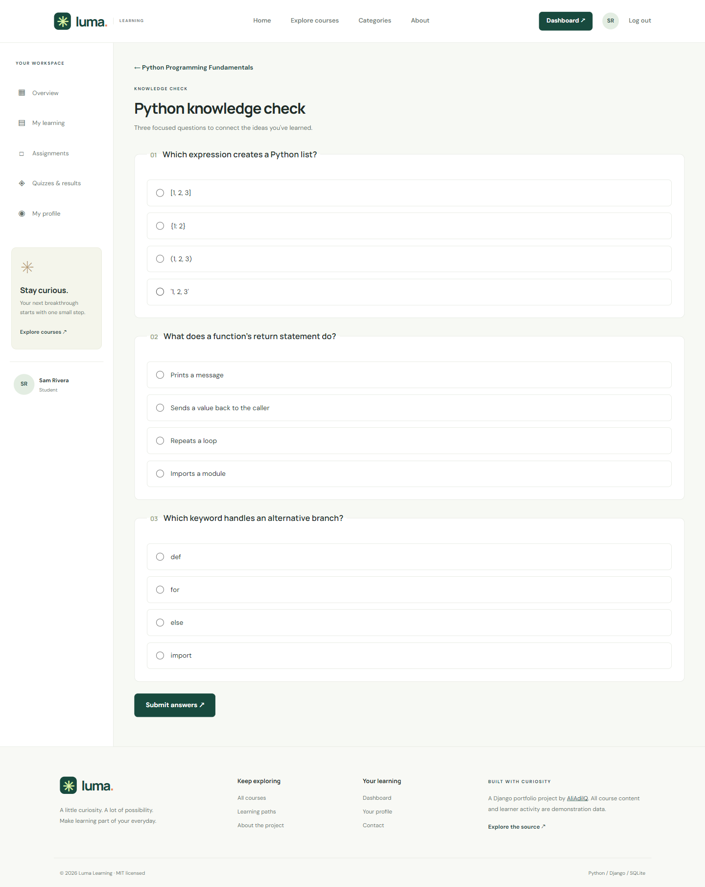

**Login**

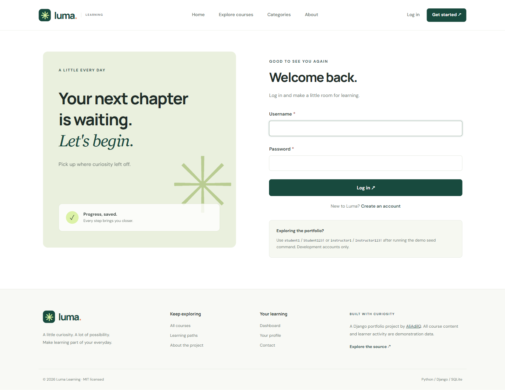

**Django administration**

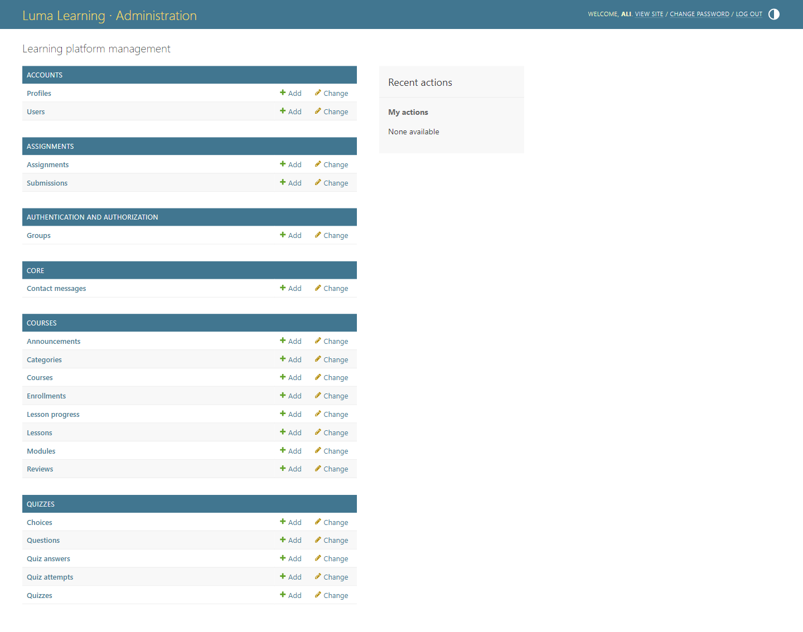

**Full homepage**

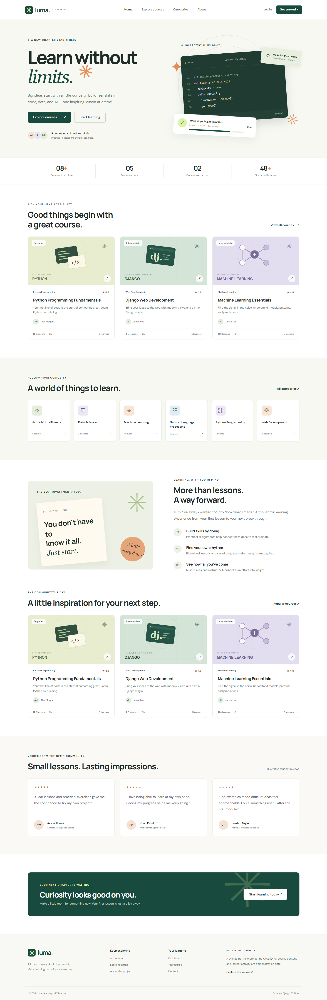

</details>

<details>
<summary><strong>Responsive mobile views</strong></summary>

| Homepage | Student workspace | Instructor studio |
| --- | --- | --- |
| 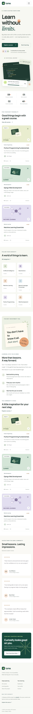 | 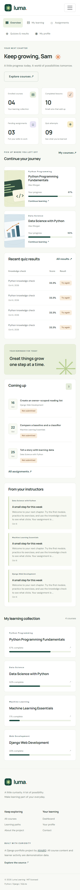 | 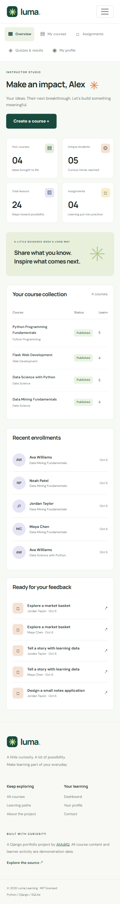 |

</details>

## Tech stack

- **Backend:** Python 3.12, Django 5.2.17
- **Frontend:** HTML5, CSS3, Bootstrap 5.3.3, vanilla JavaScript
- **Database:** SQLite3, with committed Django migrations
- **Uploads:** Pillow 12.3.0 for images; private filesystem storage for assignment files
- **Development tools:** Django's test runner, Ruff, djLint; optional Playwright browser checks

Runtime dependencies, including Django's transitive dependencies, are pinned to the versions tested. Bootstrap is vendored locally with its license. Original SVG course artwork is included. DM Sans and Manrope are requested from Google Fonts; system fonts provide a fallback when offline. No email service, external database, Redis, Docker, or paid API is required.

## Installation

Use **Python 3.12 or newer**. Python 3.8 is not supported. Commands below use an activated virtual environment.

```bash
git clone https://github.com/AliAdilQ/Django_Learning_Management_System.git
cd Django_Learning_Management_System
python -m venv venv
```

Activate it on **Windows PowerShell**:

```powershell
.\venv\Scripts\Activate.ps1
```

If PowerShell prevents activation, you can run commands through `venv\Scripts\python.exe` directly. On **Windows Command Prompt**:

```bat
venv\Scripts\activate.bat
```

On **macOS / Linux**:

```bash
source venv/bin/activate
```

Install, initialize the database, populate demo content, and start the application:

```bash
python -m pip install -r requirements.txt
python manage.py migrate
python manage.py seed_data
python manage.py runserver
```

Open [http://127.0.0.1:8000/](http://127.0.0.1:8000/). Administration is at [http://127.0.0.1:8000/admin/](http://127.0.0.1:8000/admin/).

### Environment configuration

Local development works immediately without a `.env` file. To customize settings, copy `.env.example` to `.env`:

```powershell
# Windows PowerShell
Copy-Item .env.example .env
```

```bash
# macOS / Linux
cp .env.example .env
```

| Variable | Local default | Purpose |
| --- | --- | --- |
| `DJANGO_DEBUG` | `True` | Development pages and local public media serving |
| `DJANGO_SECRET_KEY` | Explicit development-only value | Override with a unique secret outside development |
| `DJANGO_ALLOWED_HOSTS` | `localhost,127.0.0.1,testserver` | Comma-separated hostnames; the example file omits `testserver` |

The small `.env` reader supports `KEY=value` lines, optional outer quotes, and full-line comments. Environment variables take precedence. It does not perform shell interpolation. SQLite is always stored as `db.sqlite3` beside `manage.py`.

## Demo credentials

**These accounts are provided only for local demonstration and development. Never use these passwords in production or expose a database containing these accounts publicly.**

| Role | Username | Email | Password |
| --- | --- | --- | --- |
| Administrator | `admin` | `admin@example.com` | `Admin123!` |
| Instructor | `instructor1` | `instructor1@example.com` | `Instructor123!` |
| Instructor | `instructor2` | `instructor2@example.com` | `Instructor123!` |
| Student | `student1` | `student1@example.com` | `Student123!` |
| Additional students | `student2` through `student5` | Corresponding `@example.com` addresses | `Student123!` |

`seed_data` creates 8 users, 6 categories, 8 courses, 16 modules, 48 lessons, assignments, quizzes with questions and choices, announcements, reviews, submissions, enrollments, saved progress, and completed quiz attempts.

The command runs atomically and can be repeated without duplicating its demo records. It preserves existing passwords and edited content. A conflicting demo username with a different role aborts the transaction. Seeding is refused when `DEBUG=False`. Demo passwords are set only by this explicit command; authentication uses Django's normal password hashing and validation.

## Usage

### Students

1. Register a student account or log in as `student1`.
2. Browse courses, filter by topic and difficulty, and open a curriculum.
3. Enroll and use **Continue learning** to resume the first incomplete published lesson.
4. Mark lessons complete. Progress is calculated from completed published lessons; completion is idempotent.
5. Open course activities or the **Assignments** page. Submit text or a PDF/TXT/Markdown file up to 5 MB. You can revise work until it is graded. Late work is accepted and labeled.
6. Start a quiz, choose one answer per question, and submit. Attempts, scores, pass thresholds, and answer snapshots are saved. Timed quizzes begin on **Start quiz**; late submissions receive zero marks.
7. Review instructor feedback and course announcements, leave or edit a review, and update your profile.

### Instructors

1. Log in as `instructor1` or `instructor2` to open the instructor studio.
2. Create a course, then add modules and ordered lessons. Publish the course when it is ready.
3. Add assignments, quizzes, and announcements from the course workspace.
4. For each quiz, add questions with **at least two choices and exactly one correct answer**. Questions are locked while students have an active attempt to preserve their question set.
5. Open submissions and save marks and useful feedback. Marks cannot exceed the assignment maximum.
6. Review enrollments and course statistics. Every editing query is restricted to the signed-in instructor's courses, including submitted module and quiz identifiers.

Deleting content uses a confirmation page followed by POST. Course deletion also removes its related learning activity. Finalized quiz answer text remains available if individual questions are edited or deleted.

### Administrators

Log in at `/admin/` using the admin account. Manage users and profiles, courses and curriculum, enrollments and progress, assignments and grading, quizzes and answers, announcements, reviews, and contact messages.

Public registration always creates a student. To grant instructor access, an administrator changes a user's **Learning role** to Instructor. Staff/superuser access is managed separately through Django's permissions controls. New production administrators should be created with `python manage.py createsuperuser`, on a clean database without demo accounts.

All stored dates and assignment deadlines use UTC and are labeled accordingly. Courses have an estimated duration in hours; lessons have a duration in minutes. Videos open as HTTPS links; video hosting is not part of this project. Contact messages are stored for administrators and do not send email.

## Project structure

```text
Django_Learning_Management_System/
├── manage.py
├── requirements.txt / requirements-dev.txt
├── README.md / CONTRIBUTING.md / SECURITY.md / LICENSE
├── .env.example / .gitignore / .editorconfig / pyproject.toml
├── .github/workflows/tests.yml
├── config/                 # Settings, root URLs, WSGI and ASGI
├── accounts/               # Custom user, profile, authentication, admin
├── courses/                # Catalog, curriculum, enrollment, progress, reviews
├── assignments/            # Private submissions, grading, downloads
├── quizzes/                # Questions, choices, timed attempts and scoring
├── core/                   # Public pages, dashboards, scoped instructor CRUD
│   ├── management/commands/seed_data.py
│   └── tests.py            # Integration and permission tests
├── templates/              # Inheritance, reusable includes, role layouts
├── static/
│   ├── css/ / js/
│   ├── images/courses/     # Original SVG course covers
│   └── vendor/             # Bootstrap CSS, JS and upstream license
├── tools/                  # SVG builder and optional browser verification
├── docs/screenshots/       # Real application screenshots
└── package.json            # Optional Playwright development dependency
```

Migrations are included within each app. `db.sqlite3`, `media/`, `private_uploads/`, virtual environments, and collected static output are created locally and ignored by Git. The repository intentionally uses the seed workflow instead of committing a database or uploaded personal files.

## Testing

Run the integration suite and Django checks:

```bash
python manage.py check
python manage.py makemigrations --check --dry-run
python manage.py test
```

The suite covers public pages, search/filtering, registration and login, safe redirects, CSRF, duplicate enrollment, role access, ownership checks, foreign-module injection, instructor CRUD, question validation, private downloads, grading bounds, late submissions, quiz scoring and timers, result privacy, review updates, profiles, password changes, branded errors, and seed stability. Tests use a separate temporary database and do not modify your demo database.

For formatting and linting:

```bash
python -m pip install -r requirements-dev.txt
ruff check .
ruff format --check .
djlint templates --check --quiet
```

GitHub Actions installs the pinned dependencies, checks Python formatting, validates migrations, runs migrations and the seed twice, and runs the Django tests.

### Optional browser verification and screenshot refresh

With the seeded development server running in another terminal, install the optional Node.js development tooling:

```bash
npm install
npx playwright install chromium
npm run test:browser
```

The browser script checks real public pages, search, student/instructor/admin logins, quiz submission, lesson access, responsive navigation, mobile/tablet overflow, missing images, server errors, and JavaScript errors. It refreshes `docs/screenshots/` and creates a genuine demo quiz attempt. Python runtime operation does not require Node.js.

Optional environment variables: `LMS_BASE_URL` selects a different local server; `PLAYWRIGHT_CHROMIUM_EXECUTABLE` selects an existing Chromium executable. Run this script against a local demo database, since it exercises accounts and submits a quiz.

## Security and deployment notes

- CSRF protection and POST-based enrollment, logout, completion, review, and deletion actions.
- Public forms exclude roles and privileged user flags. Ownership and enrollment are checked server-side.
- Unique database constraints protect enrollments, progress, reviews, submissions, and active attempts.
- Assignment files are stored **outside public media** and served as attachments only to the submitting student, course owner, or superuser. File extensions, size, text encoding, and PDF signatures are checked. Image uploads are restricted to JPEG/PNG/WebP with size and dimension limits.
- Templates escape learner and instructor content. Lessons are plain text, rather than arbitrary HTML.
- `DEBUG=False` requires a unique secret of at least 50 characters and enables secure cookies, HTTPS redirection, and HSTS. Custom error pages are used in this mode.
- A public deployment needs a production WSGI/ASGI server, HTTPS, explicit hosts, static/media serving, backups, request throttling, and deployment-specific upload scanning. The Django development server is for local use.

See [SECURITY.md](SECURITY.md) for the implemented boundaries and reporting guidance. No production-readiness or malicious-file-scanning guarantee is implied by this portfolio demo.

## Future improvements

These are potential extensions, **not implemented features**: REST API, React client, hosted video integration, completion certificates, payment integration, email notifications/password reset delivery, real-time discussions, and cloud deployment.

## Author

**AliAdilQ** · [GitHub profile](https://github.com/AliAdilQ) · [Project repository](https://github.com/AliAdilQ/Django_Learning_Management_System)

## License

MIT License — see [LICENSE](LICENSE). Vendored Bootstrap retains its [upstream MIT license](static/vendor/BOOTSTRAP-LICENSE.txt). Course illustrations are original project assets.
